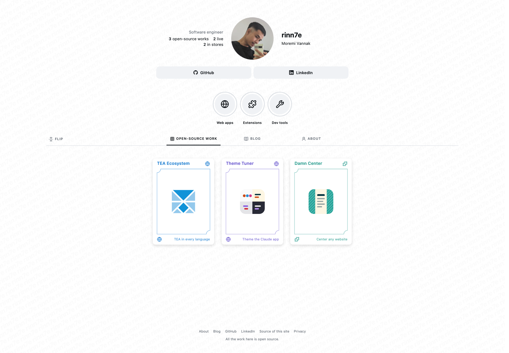

<p align="center">
  
</p>

<h1 align="center">rinn7e.com</h1>

<p align="center">
  The landing page of my open source products: browser extensions, web apps, games and developer tools.
</p>

<p align="center">
  <a href="https://github.com/rinn7e/rinn7e.github.io/actions/workflows/deploy.yml"></a>
  <a href="LICENSE"></a>
</p>

[rinn7e.com](https://rinn7e.com/) is laid out like a profile page: my photo and name, the counts of the products, links to my GitHub and LinkedIn, highlights for the product categories (each filters the grid) and three tabs, Open-source work, Blog and About, with a Privacy page in the footer. The Open-source work tab is a grid of portrait playing cards, one per project, that tilt under the pointer, and the Flip button turns them all over to their backs. A click opens a popup: the card flies into it with a spin while a slideshow of its screenshots, a short description and its links (the live app, the browser stores, the code) fade in. The Blog tab lists my posts, newest first, with the posts of the last 30 days marked New. Each post has its own page here, its canonical home; a post that is also on [dev.to](https://dev.to/rinn7e) links to its discussion there. The site follows the light or dark theme of the system. The About tab links my LinkedIn and my GitHub.

## Screenshot



## Add a product

1. Put its screenshots in `public/shot/<product id>/` as `1.webp`, `2.webp` and so on (at most 1200 px wide).
2. Put its logo in `public/logo/`, or give it a monogram if it has no logo of its own.
3. Add an entry to `productList` in `src/common/data/product.ts`: its id, name, kind, description, categories, logo, color, screenshots and links.

Only public repositories go here, and no libraries.

## Add a blog post

Each post is one Markdown file, `content/blog/<slug>.md`: a front matter, then the body. The slug is its address, `/blog/<slug>`.

```yaml
---
title: Command Sourcing vs Event Sourcing
description: One or two sentences, shown in the list and in link previews.
date: 2026-11-26
tags:
  - architecture
  - database
---
```

Its pictures go in `public/blog/<slug>/`, and the body links them as `/blog/<slug>/<name>.<ext>`. A picture may also have a version for the dark theme, `<name>.dark.<ext>` next to it: the page then shows the one that matches the theme of the system. A picture without one is shown in both themes.

The build renders the Markdown to HTML, with the code colored by highlight.js (`tool/blog/`), so the browser gets no Markdown code. Raw HTML in a post is shown as text. Prettier leaves `content/` alone, so a post stays as written.

### Publish a new post (required: here and on dev.to)

Every new post lives in both places, linked both ways: the page here is the original, and dev.to has a copy that points back to it. A post is not done until all of these steps are:

1. Write the post here (above) and push it. Wait for the deploy, then open `https://rinn7e.com/blog/<slug>/` and check it.
2. Publish the copy on [dev.to](https://dev.to/new) with the same title, the same description and the same tags (dev.to takes at most 4).
3. Give the copy the canonical URL `https://rinn7e.com/blog/<slug>/` (`canonical_url` in the front matter of the editor of dev.to), so search engines count the post here.
4. Give its pictures absolute addresses, as PNG or WebP. dev.to serves an SVG with the type `image/webp`, and browsers do not draw it. Render each picture to PNG (the light version) and upload it in the editor of dev.to; check them in its Preview before publishing.
5. Add `devToUrl: <the address of the copy on dev.to>` to the front matter of the post here, and push. Its page then shows a dev.to link and "Join the discussion on dev.to". Do not add `devToId`: the import would then replace the file with the copy.
6. Check both sides: the page here links the copy, and the API of dev.to (`https://dev.to/api/articles/rinn7e/<its dev.to slug>`) shows it published with the right `canonical_url`.

Keep the title the same on both sides: the import leaves a post without `devToId` alone and skips the dev.to post of the same slug, but a copy under another title would come back as a second file.

### Import from dev.to

The older posts were first written on [dev.to](https://dev.to/rinn7e) and are copied here, with `devToUrl` and `devToId` in their front matter. Their pictures are in `public/blog/<slug>/`, so the site shows them from itself.

```bash
pnpm run blog:import
```

The import reads every post through the public API of dev.to, writes its file and saves its pictures. A post imported before keeps its file and its slug (rename the file to change its address); a new one gets the slug of dev.to without its random ending. Read the diff before committing.

## Development

Built with React and [`react-tea-cup`](https://github.com/vankeisb/react-tea-cup) (The Elm Architecture), `fp-ts`, Tailwind CSS v4 and Vite. The code follows [`doc/code-convention.md`](doc/code-convention.md).

Needs Node.js 24 and pnpm.

```bash
pnpm install
```

```bash
pnpm dev
```

Checks, as the deploy runs them:

```bash
pnpm run check && pnpm run lint && pnpm run format:check && pnpm test
```

## Deploy

GitHub Pages serves `dist/` at [rinn7e.com](https://rinn7e.com/). `.github/workflows/deploy.yml` checks, builds and deploys every push to `master`. The custom domain is set in the Pages settings of the repository, with "GitHub Actions" as the source. The build writes a copy of the app for every page (`index.html`, `blog/index.html`, `about/index.html`, `privacy/index.html` and `blog/<slug>/index.html` for each post), each with its own title, description, canonical URL and link preview, and its content rendered ahead of time, so a visitor sees the page before the script loads, the script then takes it over, and search engines read every page. Each page also gets its own share image (`og/page/<page>.png`, `og/blog/<slug>.png`, 1200x630), drawn at build time. Then `404.html`, left out of search, and `sitemap.xml` (see "Search engines" in `doc/code-convention.md`).

Each blog post names its page here as its canonical URL. On dev.to, set the canonical URL of each post (its settings, "Canonical URL") to its address here, so search engines count the post on this site.

The other GitHub Pages projects of `rinn7e` (such as `/claude-desktop-theme-tuner/`) are served under this domain by their own repositories, so no route of this site may use their names.

## License

The code is licensed under the GNU General Public License v3.0. See the [LICENSE](LICENSE) file for details.
